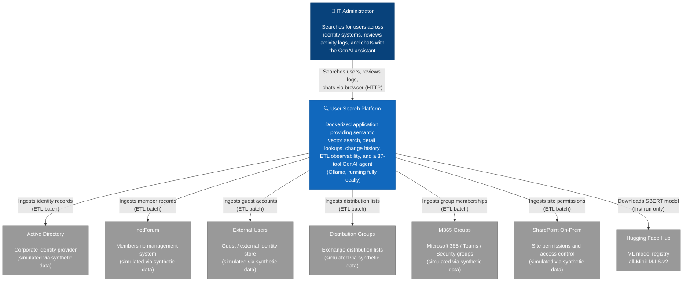

# User Search

A semantic search and AI agent platform for identity and access data. It consolidates six identity/access sources — Active Directory, netForum, External Users, Distribution Groups, M365 Group Memberships, and SharePoint Permissions — into a single searchable, chat-driven interface, backed by vector search and a local LLM agent that can actually take action, not just answer questions.

Built as a personal project to explore semantic search over structured identity data and LLM tool-calling for real governance/IT-admin workflows. All data is synthetic; everything runs locally via Docker.

## What it does

- **Cross-source semantic search** — find a person by name, email fragment, or plain-English description; results are ranked by vector similarity (SBERT embeddings), not keyword matching.
- **Unified detail view** — one card shows a user's standing across every source system, plus group memberships, SharePoint permissions, and full change/activity history.
- **AI agent with real actions** — a 37-tool LLM agent (Ollama, running fully locally) can provision/disable accounts, manage group and SharePoint access, reset MFA, assign licenses, run governance checks (stale guests, naming violations, missing owners, oversharing risks), and more — every write action is ticketed and auditable.
- **Governance & compliance tracking** — tracked violations with severity/age, policy-rule overrides, automated remediation proposals with human approval gating, and a live compliance score.
- **Observable ETL pipelines** — six independent pipelines ingest, vectorize, and change-detect records on a schedule, with full job history.

## Architecture at a glance



More diagrams (sequence, ER, ETL data flow, Docker topology, agent architecture) live in [docs/diagrams/](docs/diagrams/README.md).

## Tech stack

Node.js 22 · Express · PostgreSQL 15 + pgvector (HNSW indexes) · SBERT (`all-MiniLM-L6-v2`) via `@xenova/transformers` · Ollama (`qwen2.5:3b`) for local LLM tool-calling · Docker Compose · Jest · ESLint

Full inventory with versions: [docs/technology-stack.md](docs/technology-stack.md)

## Quickstart

```sh
./startup/setup.sh
```

This builds every image, starts Postgres, initialises the schema, starts all six ETL lines plus the app and GenAI services, and pulls the Ollama model. Once it finishes, open **[http://localhost:3000](http://localhost:3000)**, search for a user, and open their card to try the agent.

```sh
./startup/teardown.sh            # stop containers, keep data
./startup/teardown.sh --destroy  # stop containers, remove all data & images
```

For individual services, manual compose commands, database initialisation, and synthetic data regeneration, see [docs/README.md](docs/README.md).

## Documentation

| Doc | Covers |
|---|---|
| [docs/README.md](docs/README.md) | Full dev setup, Docker Compose fragments, seeding, linting |
| [docs/technology-stack.md](docs/technology-stack.md) | Every technology/library/model in the solution |
| [docs/etl-architecture.md](docs/etl-architecture.md) | ETL pipeline design and full database schema reference |
| [docs/diagrams/](docs/diagrams/README.md) | C4, sequence, entity-relationship, and state diagrams |
