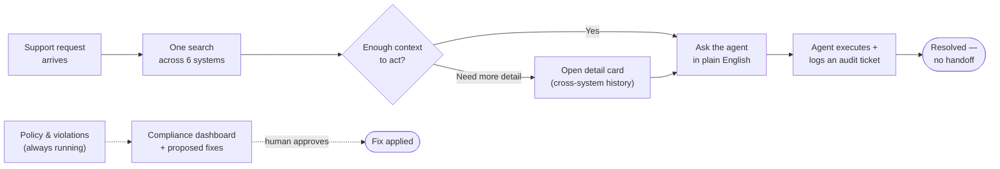

# User Search — One-Page Overview

A single-page summary of the problem, the solution, how it works, what it's
worth, and how it was built. Each section links to the full deep-dive
document it's condensed from.

---

## The Problem Being Solved

A 20,000+ identity organisation manages users across **six independent
systems** — Active Directory, netForum, External Users, Distribution
Groups, M365 Groups, and SharePoint Permissions — with no single view of a
user and no single team able to resolve a cross-system issue end to end.

A routine request (provision an account, reset MFA, explain a login block)
routinely requires **2–3 team handoffs** and **1–4 hours** to resolve,
because diagnosing which systems are involved requires checking each one
manually. At a conservative 10 cross-system requests a week, this costs
roughly **1,000 staff-hours a year** in coordination alone, plus repeated
interruptions to delivery teams who get pulled in because they hold system
access, not because the work needs their expertise.

*Full detail: [problem.md](problem.md)*

---

## Proposed Solution

**User Search** — a working proof of concept — consolidates all six systems
into one semantically-searchable database and layers an AI agent on top
that can diagnose and act on the majority of issues in a single session.

| Layer | What it does |
|---|---|
| **ETL (6 pipelines)** | Ingests and vectorises all six systems hourly, with full change-history tracking |
| **Database** | PostgreSQL + pgvector, 20 tables, semantic (not just keyword) search |
| **Application** | Unified search UI, cross-system detail view, and a compliance dashboard (score, trends, reports, policy rules) |
| **AI Agent** | 57 tool-calling actions — account operations, M365 service desk, lifecycle management, access requests, and a full governance layer (detection, configurable policy engine, approval-gated auto-remediation) |

The governance layer is a direct answer to a question most organisations
can't currently answer with confidence: *are we actually following our own
naming, ownership, and sharing policies — and can we prove it?* Violations
are detected continuously (not just at audit time), fixes are proposed
automatically, and nothing is ever applied without an explicit human
approval.

*Full detail: [solution.md](solution.md)*

---

## Simple Workflow Diagram

The top path replaces a 2–3 team handoff chain with a single analyst
session. The bottom path runs continuously in the background, surfacing
governance problems before they become audit findings — never applying a
fix without a human approving it first.

---

## Expected Benefits & Estimated Cost

| Benefit | Estimate |
|---|---|
| Coordination time recovered | **~1,075 staff-hours/year** |
| Delivery team focus recovered | **~250–300 hours/year** (5-person team) |
| Governance & compliance automation | Continuous detection + approval-gated auto-fix — **already built**, no added engineering cost |
| Secondary value | License recovery, stale-guest cleanup, consolidated audit trail |

| Cost | Estimate |
|---|---|
| Production infrastructure (AWS, EKS + Bedrock) | **~$3,540/year** (~$295/month) |
| Engineering to production (3 workstreams: live data, cloud deployment, SAML auth) | **10–15 weeks** (1 engineer) / **6–9 weeks** (2 engineers) |

If the recovered coordination hours have any material value to the
organisation, the infrastructure cost is recovered within the first few
weeks of operation. The engineering estimate is scheduling work against a
fully documented plan, not open research — every workstream has a written
implementation guide in this repository already.

*Full detail: [benefits.md](benefits.md)*

---

## AI Usage Disclosure

AI is used in this platform in two distinct ways:

1. **As a functional part of the product** — a sentence-embedding model
   (SBERT `all-MiniLM-L6-v2`) powers semantic search, and a tool-calling LLM
   powers the agent (a local open-source model, `qwen2.5:3b` via Ollama, for
   this demo; Amazon Bedrock in production). Microsoft Graph API calls
   execute the agent's M365 actions when live credentials are configured.
2. **As a development tool** — GitHub Copilot (Claude Sonnet 4.6 / 5) was
   used extensively, under direct human direction and review at every step,
   to help build the database schema, the governance/policy/remediation
   engine, the dashboard UI, and this documentation set.

Nothing described above was generated and shipped unattended — every change
was driven by an explicit human prompt and reviewed before deployment.

*Full detail: [aiusage.md](aiusage.md)*

---

*See [presentation.md](presentation.md) for a 10-minute spoken walkthrough
of this same material.*
