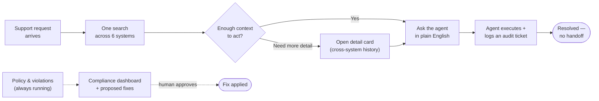

# User Search — 10-Minute Presentation

A speaker script for a ~10-minute walkthrough (≈1,450 words at a natural
150 wpm pace, plus time for the diagram and a live demo pause). Timing cues
are guidance, not a stopwatch requirement — adjust to the room.

Deeper material backing each section: [problem.md](problem.md) ·
[solution.md](solution.md) · [benefits.md](benefits.md) · [aiusage.md](aiusage.md)

---

## [0:00–0:45] Open with the problem in one breath

> "We manage identity for 20,000+ people across six separate systems —
> Active Directory, netForum, External Users, Distribution Groups, M365
> Groups, and SharePoint permissions. None of them talk to each other. So
> when a routine request comes in — provision an account, reset MFA, explain
> why someone's locked out — our first-line team can't finish it alone. They
> have to hand it to someone else, who often has to hand it to a third team.
> That's not a training problem. That's a missing layer."

(Pause. Let that land before moving on.)

---

## [0:45–2:00] The cost of the status quo

> "Here's what that actually costs us today:
>
> - 6 to 20 cross-system requests a week
> - 1 to 4 hours to resolve each one, end to end
> - 2 to 3 teams looped in, on average, per issue
> - Delivery teams interrupted multiple times a week to help with support
>   that isn't really their job
>
> At a conservative 10 requests a week, that's roughly **1,000 hours a year**
> just coordinating handoffs — before anyone actually fixes anything. And
> every interruption to a delivery engineer costs 15 to 30 minutes of
> refocus time on top of the interruption itself.
>
> This isn't anyone's fault. Every one of those six systems is legitimate
> and necessary. What's missing is a layer that sits across all of them."

---

## [2:00–2:15] The turn

> "So we built that layer. Not a slide deck — working code, running today,
> against realistic synthetic data at real volume. I want to show you what
> it does, then what it's built from, then what it would cost to put into
> production."

---

## [2:15–5:00] The solution — one search, one agent, one dashboard

> "Three things changed for the support analyst."

**1. One search, every system.**
> "They type a name, an email fragment, or even a plain description — 'Jane
> Smith contractor' — and get back results from all six systems in one
> query, instantly, with a badge showing which systems each person exists
> in. No more checking six consoles one at a time."

**2. One conversation, real actions.**
> "From that same screen, they talk to an AI agent in plain English: 'reset
> their MFA', 'add them to the finance distribution list', 'this guest
> account looks stale, revoke it'. The agent picks the right action out of
> 57 available tools, executes it, and logs an auditable ticket
> automatically. No handoff, no second tool, no waiting on another team."

**3. One dashboard for governance.**
> "And separately — without needing a specific person pulled up — there's a
> compliance dashboard. A live 0-to-100 posture score. Violation detection
> that runs continuously, not just at audit time: bad naming conventions,
> groups with no owner, SharePoint shared too broadly. When something's
> wrong, a fix is proposed automatically — but nothing is ever applied
> without a human clicking approve. Same review model people already trust
> from tools like GitHub Copilot."

(Show the diagram below, or switch to a live demo here if the room allows.)

> "Top path: a support request, resolved in one sitting, by one person.
> Bottom path: governance running continuously in the background, surfacing
> problems before they become an audit finding — and never fixing anything
> without a human saying yes first."

---

## [5:00–6:30] This is built, not proposed

> "Everything I just described is running right now. Six automated ETL
> pipelines feeding a single PostgreSQL database with vector search built
> in — 20 tables, real semantic matching, not keyword search. The AI agent
> runs entirely locally in this demo using a small open model — zero cloud
> dependency to show you this today. In production that one piece swaps for
> Amazon Bedrock; nothing else about the architecture changes.
>
> One command brings up the whole stack: `./startup/setup.sh`. That's the
> level of maturity we're at — this isn't a prototype held together by
> hand, it's a system you can stand up and tear down reliably."

---

## [6:30–8:00] What this is worth

> "Translating the hours I mentioned earlier into outcomes:
>
> - **~1,075 staff hours recovered per year** from eliminating handoff
>   coordination — time that goes back to the teams currently spending it
> - **~250 to 300 hours a year recovered** for a five-person delivery team,
>   just from not being interrupted
> - Governance and compliance checking that used to be a periodic audit
>   project is now continuous and already built — no extra engineering
>   cost to get it
> - Plus the quieter wins: reclaimed unused licenses, cleaned-up stale
>   guest accounts, a consolidated audit trail instead of six separate ones
>
> Running this in AWS production is estimated at **roughly $3,500 a year**
> in infrastructure. If those recovered hours have any value to this
> organisation at all, that cost is recovered in the first few weeks."

---

## [8:00–9:00] What it takes to go live

> "Three workstreams, fully documented, none of them architectural
> unknowns:
>
> 1. **Real data connections** — swap synthetic files for live Microsoft
>    Graph and netForum APIs. 3 to 5 weeks.
> 2. **Cloud deployment** — move from Docker to AWS (RDS, EKS, Bedrock).
>    4 to 6 weeks.
> 3. **Authentication** — SAML single sign-on through our existing Entra ID,
>    with real role-based permissions. 3 to 4 weeks.
>
> That's 10 to 15 weeks for one engineer, or 6 to 9 weeks with two working
> in parallel. Every one of these has a written implementation plan in the
> repository today — this is scheduling work, not research work."

---

## [9:00–10:00] Close

> "To summarise: a real, structural cost that's been accepted as normal for
> too long; a working system, not a pitch, that eliminates it; a governance
> layer that proves policy is being followed instead of hoping it is; and a
> clear, scheduled path to production at a cost that pays for itself almost
> immediately.
>
> What I'd like from this room is a decision to schedule the three
> production workstreams. Happy to take questions, or show you the live
> search and agent right now if you'd like to see it work."

---

*Speaker tip: the demo (live search → detail card → ask the agent to do
something → show the compliance dashboard) lands better than any slide. If
time allows, cut the "What it takes to go live" section to one line and
spend the saved two minutes live in the app instead.*
