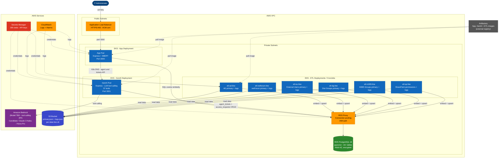

## Primary — EKS (App + ETL + GenAI on shared cluster)

> **Fallback — Lambda (native Node.js zip packages, if EKS is not available)**
>
> If EKS cannot be used, both the App and all 6 ETL services fall back to Lambda using the Node.js 22 runtime (zip package deployment, no container images or ECR required). The App becomes a native Lambda handler wired to API Gateway; ETL functions are triggered by EventBridge on a 1-hour schedule. The GenAI service remains on EKS or Bedrock as above.

## Fallback — Lambda (App + ETL as native Node.js Lambda functions)

```mermaid
flowchart TB
    classDef person fill:#08427B,stroke:#073B6F,color:#fff
    classDef aws fill:#FF9900,stroke:#CC7A00,color:#000
    classDef lambda fill:#D86613,stroke:#B8520F,color:#fff
    classDef eks fill:#1168BD,stroke:#0E5BA7,color:#fff
    classDef rds fill:#2D882D,stroke:#226622,color:#fff
    classDef storage fill:#3B48CC,stroke:#2F3AA3,color:#fff
    classDef security fill:#DD3522,stroke:#B72B1C,color:#fff
    classDef bedrock fill:#7B2D8E,stroke:#5E2270,color:#fff
    classDef external fill:#555555,stroke:#333333,color:#fff

    User([IT Administrator]):::person

    subgraph VPC[AWS VPC]
        direction TB

        subgraph Public[Public Subnets]
            APIGW["API Gateway\nHTTPS - custom domain"]:::aws
        end

        subgraph Private[Private Subnets]
            AppLambda["App Lambda\nnodejs22.x native handler\nExpress + SBERT"]:::lambda

            subgraph GenAISvc[EKS - GenAI Deployment]
                GenAI["GenAI Pod\nExpress - LLM tool-calling\n37 tools\nPort 3001"]:::eks
            end

            subgraph ETLFns[Lambda Functions - EventBridge Scheduled]
                L_AD["etl-ad-line\nAD primary + logs"]:::lambda
                L_NF["etl-netforum-line\nnetForum primary + logs"]:::lambda
                L_EU["etl-eu-line\nExternal Users primary + logs"]:::lambda
                L_DG["etl-dg-line\nDist Groups primary + logs"]:::lambda
                L_M365["etl-m365-line\nM365 Groups primary + logs"]:::lambda
                L_SP["etl-sp-line\nSharePoint permissions + logs"]:::lambda
            end

            RDSProxy["RDS Proxy\nConnection pooling\nIAM auth"]:::aws
            RDS[("RDS PostgreSQL 18\npgvector - 16+ tables\nMulti-AZ, encrypted")]:::rds
        end
    end

    subgraph AWSServices[AWS Services]
        Bedrock["Amazon Bedrock\n(Model TBD - tool-calling API)"]:::bedrock
        S3[("S3 Bucket\nprimary.json + logs.json\nper data line x6")]:::storage
        EB["EventBridge\nrate: 1 hour"]:::aws
        SM["Secrets Manager\nDB creds - API keys"]:::security
        LambdaLayer["Lambda Layer\nSBERT model weights (~80 MB)"]:::storage
        CW["CloudWatch\nLogs + Alarms"]:::aws
    end

    User -->|HTTPS| APIGW
    APIGW -->|proxy| AppLambda
    AppLambda -->|agent API calls| GenAI
    AppLambda -->|SQL cosine similarity| RDSProxy
    GenAI -->|tool-calling| Bedrock
    GenAI -->|CRUD| RDSProxy
    RDSProxy --> RDS

    EB -->|schedule trigger| L_AD
    EB -->|schedule trigger| L_NF
    EB -->|schedule trigger| L_EU
    EB -->|schedule trigger| L_DG
    EB -->|schedule trigger| L_M365
    EB -->|schedule trigger| L_SP

    L_AD & L_NF & L_EU & L_DG & L_M365 & L_SP -->|read data| S3
    L_AD & L_NF & L_EU & L_DG & L_M365 & L_SP -->|embed + upsert| RDSProxy

    LambdaLayer -.->|SBERT weights| L_AD
    LambdaLayer -.->|SBERT weights| L_NF
    LambdaLayer -.->|SBERT weights| L_EU
    LambdaLayer -.->|SBERT weights| L_DG
    LambdaLayer -.->|SBERT weights| L_M365
    LambdaLayer -.->|SBERT weights| L_SP
    LambdaLayer -.->|SBERT weights| AppLambda

    SM -.->|credentials| AppLambda
    SM -.->|credentials| GenAI
    SM -.->|credentials| RDSProxy
    CW -.->|logs| AppLambda
    CW -.->|logs| GenAI
    CW -.->|logs| L_AD
```

