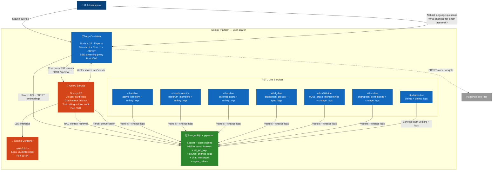

# GenAI Architecture (C4 Container — Current State)

> Current local state: 7 ETL lines, 28 user-card agent tools, Graph mock fallback for local development, and a separate claims ETL line for the planned Member Benefits Bot. See `docs/next-steps/agentic-ai-expansion.md` for the remaining production-hardening work.

