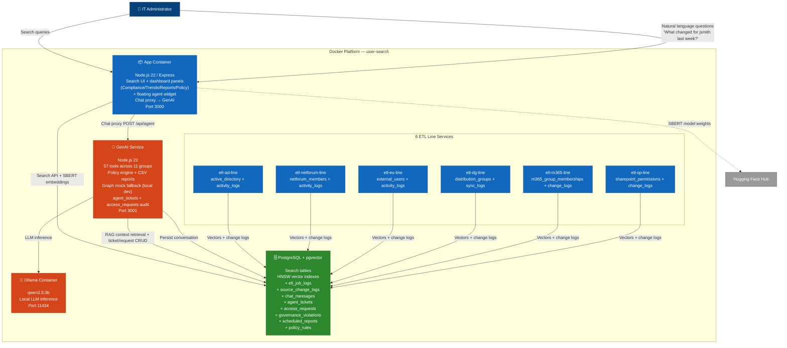

# GenAI Architecture (C4 Container — Current State)

> Current local state: 6 ETL lines, 57 agent tools across 11 groups (account operations, M365 service desk, lifecycle management, access requests, department templates, governance detection & remediation, violation tracking, compliance reporting, policy rule engine, M365 governance actions, ticketing), reachable from a per-user detail card or a floating chat icon (no user context) with server-side tool scoping between the two, Microsoft Graph mock fallback for local development.

